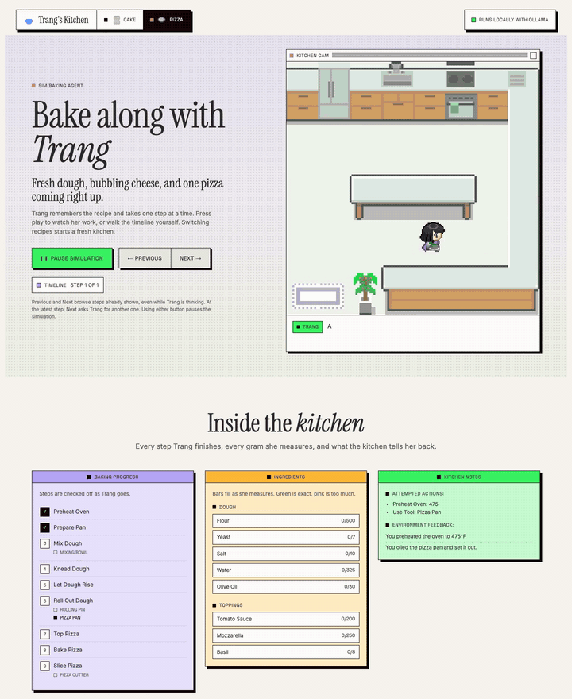
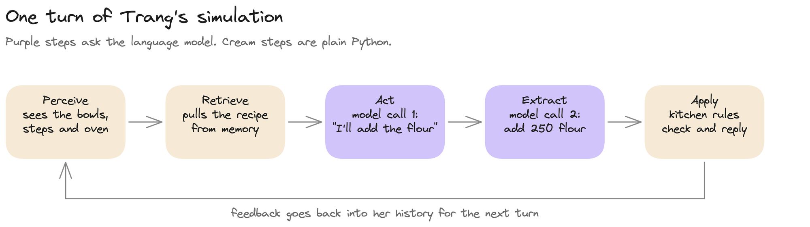

# Sim Baking Agent

A small simulated human named Trang who bakes in a pixel-art kitchen. She runs on a local language model through Ollama, follows a recipe from memory, and walks around the kitchen to measure, mix and bake. Pick **Cake** or **Pizza** and watch her work.



*Trang starting a pizza (2× speed, thinking pauses cut).*

## Quick start

Requires Python 3.10+ and [Ollama](https://ollama.com/download).

```bash
python -m venv .venv
source .venv/bin/activate  # Windows: .venv\Scripts\activate
pip install -r requirements.txt
ollama pull qwen3:4b-instruct
python baking_app.py
```

Make sure the Ollama service is running, then open <http://127.0.0.1:5000>.

On macOS, AirPlay Receiver uses port 5000. If the app won't start, run it on another port:

```bash
flask --app baking_app run --port 5001
```

## How Trang works



Each turn is two model calls wrapped in plain Python rules:

1. **Perceive.** The app describes the kitchen: ingredient amounts, finished steps, tools used, oven temperature.
2. **Retrieve.** Trang's memory file mixes unrelated articles with the recipes. Only the paragraphs for the chosen recipe are pulled out.
3. **Act.** The first model call, in Trang's persona, says what she does next.
4. **Extract.** A second model call turns her words into commands such as `use mixing_bowl, add 250 flour`.
5. **Apply.** The kitchen runs each command, checks it against the recipe and writes feedback into her history for the next turn.

When every step is done, the kitchen compares the final amounts with the recipe and shows a success or failure screen.

### Rules that keep her on track

A small model makes small mistakes. The kitchen is built so she can recover instead of looping:

- **Start over.** If an ingredient goes over its amount, she can empty the bowls and measure again. A preheated oven and a prepared pan stay ready.
- **No double counting.** Once an ingredient reaches its recipe amount, more of it is refused. This stops her recaps ("I've added the flour…") from being counted twice.
- **No silent failures.** A phrase that matches no action gets a reply listing the actions she can take.
- **Everyday wording.** "Fold", "combine" and "mix the dry and wet" all mean the same step.
- **Shortfall reminders.** If she mixes while an ingredient is still short, the kitchen tells her.

## Playing

- **Cake / Pizza** in the header picks the recipe and starts a fresh kitchen.
- **Play Simulation** runs Trang step by step. Press it again to pause.
- **Previous / Next** browse the steps already taken, even while Trang is thinking. At the latest step, Next asks her for a new one. Either button pauses Play.
- **Inside the kitchen** shows the recipe steps, ingredient bars (green when exact, pink when too much) and the kitchen's feedback.

## Ollama configuration

The default model is `qwen3:4b-instruct`. To use another local model or Ollama server:

```bash
export OLLAMA_BASE_URL=http://localhost:11434/v1
export LLM_MODEL=qwen3:4b-instruct
python baking_app.py
```

Both variables are optional. No OpenAI API key is needed.

## Repository structure

```text
.
├── README.md
├── requirements.txt
├── baking_app.py                  # Flask routes and app setup
├── baking_agent.py                # Agent loop: perceive, retrieve, act, reflect
├── baking/
│   ├── environment.py             # Shared kitchen rules and the cake recipe
│   ├── pizza_environment.py       # Pizza recipe rules
│   ├── recipes.py                 # Recipe name -> kitchen lookup
│   ├── trang/
│   │   ├── agent.json             # Trang's name and persona
│   │   └── memory/memory_stream.txt  # Mixed memories, including both recipes
│   ├── templates/index.html       # Game page
│   └── static/
│       ├── game.js                # Browser game: map, walking, controls
│       └── assets/                # Kitchen map, sprites, item art, end screens
├── docs/
│   ├── trang_flow.excalidraw      # Editable flow diagram
│   └── media/                     # README images and demo clip
├── scripts/
│   └── draw_pizza_art.py          # Redraws the pizza pixel art
└── simulation_engine/
    ├── gpt_structure.py           # OpenAI-compatible model requests
    └── settings.py                # Backend and model configuration
```

## Editing the art and diagram

The pizza sprites and end screens are drawn by code. Each sprite is a 16×16 grid of letters. Edit a grid in `scripts/draw_pizza_art.py`, then run:

```bash
pip install pillow
python scripts/draw_pizza_art.py
```

To change the flow diagram, open `docs/trang_flow.excalidraw` at [excalidraw.com](https://excalidraw.com) (menu → Open), edit it, and export a new PNG to `docs/media/trang_flow.png`.

## Credits

The agent design follows the ideas in [Generative Agents: Interactive Simulacra of Human Behavior](https://arxiv.org/abs/2304.03442) (Park et al., 2023).

## Repository

[Sim-Intelligence-Lab/sim_baking_agent](https://github.com/Sim-Intelligence-Lab/sim_baking_agent)
